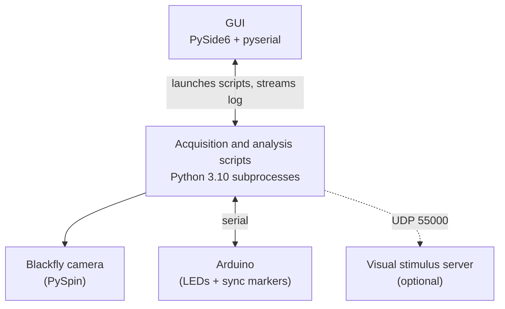
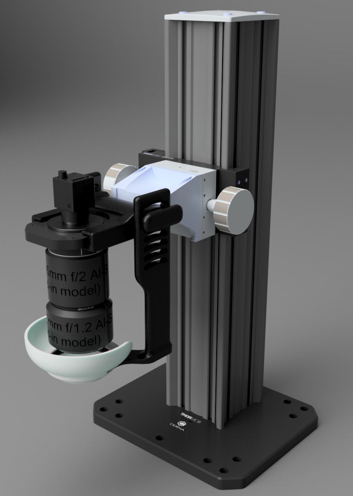

# IOI Control Panel

Open-source acquisition and analysis software for **intrinsic optical imaging
(IOI)** of mouse cortex. IOI maps where cortex responds to a stimulus by
tracking small changes in reflected light driven by local hemodynamics.

A desktop GUI wraps the full workflow: guided red/green calibration,
Arduino-triggered acquisition, and offline analysis with permutation statistics
and publication-ready figures. Lab members can run the rig without touching a
terminal.

**Status:** in routine use for acquisition and analysis in the Gonzales Lab,
Vanderbilt University.

## How it works


 
The GUI collects parameters from forms and presets, builds a command line, and
runs the scripts as **subprocesses**, streaming their output into a live log
pane. It never imports PySpin, numpy, or any acquisition code itself. All camera
and Arduino work happens in a separate Python 3.10 environment, so the GUI stays
decoupled from the Spinnaker SDK's pinned ABI and can run on a machine with no
camera SDK installed.

## Hardware

<p align="center">
  
  <br>
  <em>CAD model of the IOI macroscope.</em>
</p>

| Component | As used in the Gonzales Lab |
|---|---|
| Camera | FLIR/Teledyne Blackfly BFLY-U3-23S6M-C (Sony IMX249, 12-bit, read as Mono16) |
| Optics | Tandem-lens macroscope: 50 mm objective + 85 mm camera-side lens (Nikon F-mount, manual) |
| Illumination | Adafruit NeoPixel RGB LED rings (red and green channels) |
| Sync | Arduino Uno running `intrinsic_arduino/intrinsic_arduino.ino`. Drives the LEDs and emits the frame/stimulus markers the scripts parse. Pin map is at the top of the `.ino`. |
| Stimulus (optional) | Second monitor for drifting gratings, or a vibrotactile stimulator |

Other IMX249-class Blackfly cameras should work but have not been tested.

## Requirements

- **Windows.** The acquisition host is Windows, and the GUI's graceful stop uses
  Win32 process groups.
- **Python 3.10** for the scripts, reachable as `py -3.10`. Separate from the
  GUI's environment.
- **Spinnaker SDK and a matching `spinnaker_python` (PySpin) wheel** from
  Teledyne. These are not redistributable and are not included here. Every
  camera-dependent script fails without PySpin.
- **numpy below 2.0** in the script environment. PySpin is built against the
  numpy 1.x ABI; numpy 2.x imports fine but breaks PySpin at runtime. The cap in
  `requirements_scripts.txt` is load-bearing.
- **Arduino IDE** to flash the sync firmware.
- **pygame**, only if you run the visual stimulus server.

The GUI alone needs only `PySide6` and `pyserial` (`requirements-gui.txt`).

## Quick start

### 1. Install

Camera machines: install the Spinnaker SDK and PySpin wheel first (see
[INSTALL.md](INSTALL.md)). Then, on any machine:

```powershell
git clone https://github.com/Gonzales-Lab-Vanderbilt/IOI-Control-Panel.git
cd IOI-Control-Panel
powershell -ExecutionPolicy Bypass -File setup.ps1
```

Setup installs Python 3.10 if needed, the script and GUI packages, and an
**IOI Control Panel** shortcut on the Desktop and Start Menu. It finishes with a
report of what this machine is ready for.

### 2. Run a session

1. Flash `intrinsic_arduino/intrinsic_arduino.ino` to the Arduino.
2. If using visual stimuli, start the stimulus server:
   `py -3.10 intrinsic_visual_stimulus.py`
3. Launch the GUI from the shortcut.
4. Check the **environment** indicator in the top bar. Green means the core
   packages are present. Click it for the full report (Python and package
   versions, camera count, serial ports) in the Pre-Session Diagnostics tab.
5. Set your **spatial calibration** under Analysis (see
   [Spatial calibration](#spatial-calibration)).
6. Open the **Run Session** tab, choose a preset, and start.

### 3. Re-analyze a saved session

```powershell
py -3.10 intrinsic_analysis.py --folder .\captures\session_YYYYMMDD_HHMMSS --width 1920 --height 1200 --pixel-format Mono16
```

A standalone `.exe` of the GUI can be built with `build_exe.ps1`; see
[INSTALL.md](INSTALL.md#building-the-standalone-exe). It bundles the GUI only,
so the target machine still needs the Python 3.10 environment for anything that
touches the camera.

## Safety

Read this before running the rig unattended.

**Stop** sends a graceful break to the running script, which turns the LEDs off
in its own teardown. A hard kill is used only if the graceful stop times out,
and the UI warns you when that happens.

**Lights Off** is always available and is the backstop for a hard kill or a
crash. If a session owns the COM port, it triggers the graceful stop. If nothing
is running, it opens the port and sends `LIGHTS_OFF` directly.

**The exit code tells you whether the LEDs are off.** The GUI's status line
translates it for you. If you run scripts directly:

| Exit code | Meaning | LEDs |
|---|---|---|
| `0` | Ran to completion | Off |
| `130` | Stopped by you (Stop, Ctrl+C, Ctrl+Break) | Off |
| `2` | Command line rejected before anything ran | Never turned on |
| `1` | Script error, or refused to start (missing PySpin, bad path) | **Check the rig** |
| `-1073741510` | Killed before teardown (`STATUS_CONTROL_C_EXIT`) | **Check the rig** |
| Other negative | Terminated by the OS (e.g. access violation) | **Check the rig** |

## Analysis

### Methods

`--analysis-method` selects how an activation map is computed:

| Value | What it computes |
|---|---|
| `raw_counts` *(default)* | Post-window mean minus baseline mean in raw ADC counts, median-centered to remove global drift. |
| `fractional_reflectance` | Fractional reflectance change, with a denominator floor and low-denominator masking so near-zero baseline pixels cannot produce non-physiological values. Shorthand: `fractional`. |

`statistical_analyses.py` adds ROI time courses, leave-one-out ROI definition,
and a pixelwise t-map with permutation testing.

### Saturation is 65520, not 65535

The IMX249 is a 12-bit sensor whose output is left-shifted into Mono16:
`4095 << 4 = 65520`. Any pixel at 65520 is clipped. Treating 65535 as the
saturation value silently under-reports clipping.

### Check the trial count after every run

The session pass **skips** trials with missing arrays instead of failing, and
logs `Skipping trial ... missing analysis arrays`. If every trial is skipped, it
logs `Session analysis skipped: no trial maps available` and writes no session
map. Nothing is averaged from an empty set, but a partial skip quietly shrinks
the trial count behind the session mean.

Session folders written by older versions with an unrecognized
`analysis_method` will have every trial skipped this way.

### Spatial calibration

Calibration is rig-specific. In the GUI, set it under **Analysis → Spatial
calibration for your rig** (saved per computer in `rig_settings.json`). It
starts unset, figures get no scale bar until you enter a value, and an
unverified value asks for confirmation before each run.

From the command line, `session_poster_figures.py --um-per-px` defaults to this
lab's rig (3.682 µm/px, a 7.07 mm field across 1920 px). Pass your own value or
`--no-scale-bar`, and re-measure for your own optics before quoting any physical
distance.

A calibration saved in a session's `landmarks.json` **takes precedence** over
the rig value for that session, because calibration belongs to the optics the
session was recorded with. The scripts print when this happens.

## Landmarks and stereotaxic coordinates

In **Analysis → Landmarks**, click bregma, lambda, and two points on the
sagittal midline on the session's green reference image, then set orientation,
hemisphere(s), and the session's calibration. This saves
`<session>/landmarks.json`.

With landmarks in place, `session_poster_figures.py` marks bregma and lambda on
its figures, uses the session's own scale bar, and writes
`<label>_stereotaxic.json` with the AP/ML coordinates (mm) of the ROI, cluster,
and response-weighted center. These files are the input for cross-animal
activation maps.

<details>
<summary>Provenance, off-image landmarks, and reference points</summary>

- Mark a landmark **Estimated** unless the suture junction is actually visible.
  Provenance is carried into every coordinate derived from it.
- Optionally add a **reference point** whose stereotaxic position you know from
  the surgical record.
- **Landmarks outside the field of view:** set **Room around image** (1 to 5 mm
  of blank canvas with a 1 mm grid) and click where the landmark would be, or
  type x/y values beyond the frame (negative, or past 1920 / 1200).
- Off-image points are always Estimated and saved with `"in_field": false`.
  Every stereotaxic result reports `origin_in_field`, so maps can display
  extrapolated sessions differently. Figures draw them as an edge arrow with a
  distance label (e.g. `B? 1.5 mm`).
- The Figures tab's orientation compass is filled in from `landmarks.json` when
  one exists.
- `ioi_landmarks.py` documents the file format. It is stdlib-only and shared by
  the GUI and scripts.

</details>

## Time-lapse movies

Enable **Figures → Also render a time-lapse movie + filmstrip** to chain
`session_timelapse.py` after the figures. It produces a trial-averaged dR/R
movie aligned to stimulus onset, plus a filmstrip PNG.

<details>
<summary>How frames are timed and normalized</summary>

- Frame spacing comes from the camera clock. Stimulus timing comes from the
  Arduino's `STIM_START` / `POST_FIRST_FRAME_TRIGGER` markers, never host
  timestamps.
- Each trial is normalized to its own baseline, trials are averaged per time
  point, and all frames share one color scale.
- Frames the acquisition did not save are shown hatched as *not saved*, never
  interpolated.
- Interleaved sessions show catch trials side by side in the stimulus ROI.
- MP4 output needs ffmpeg (`imageio-ffmpeg`, in `requirements_scripts.txt`).
  Without it, the movie is written as a GIF.

</details>

## Presets

Presets in `presets/` are plain JSON whose keys map directly onto argparse
flags. They hold the advanced analysis-tuning values, so most users only see the
common controls (output folder, port, trials, ITI, stimulus, orientations).
Presets are data only: no serial connections, file handles, or camera handles
are ever serialized.

## Repository layout

| Path | Purpose |
|---|---|
| `ioi_control_panel.py`, `gui/` | The GUI (PySide6 + pyserial only) |
| `intrinsic_calibrated_imaging.py` | Main entry point: interactive calibration, then triggered imaging |
| `intrinsic_imaging.py` | Acquisition engine (`BlackflyCapture`, `TrialConfig`) |
| `intrinsic_calibration.py` | Calibration logic and interactive windows |
| `intrinsic_analysis.py` | Offline reanalysis of a saved session |
| `statistical_analyses.py` | ROI time course, leave-one-out ROI, permutation t-map |
| `session_poster_figures.py` | Per-session figure panels |
| `session_timelapse.py` | Time-lapse movie and filmstrip |
| `ioi_landmarks.py` | `landmarks.json` format and stereotaxic math |
| `intrinsic_visual_stimulus.py` | Drifting-grating stimulus server (UDP 55000) |
| `intrinsic_arduino/` | Arduino sync firmware |
| `presets/` | JSON parameter sets |
| `setup.ps1`, `verify_install.py` | One-command setup and environment report |
| `build_exe.ps1`, `ioi_control_panel.spec` | Optional standalone exe build |

Single-purpose utilities (`red.py`, `green.py`, `send_stim.py`,
`reset_blackfly_roi.py`, and others) are each surfaced as a GUI button or small
form. [INSTALL.md](INSTALL.md) has the complete file-by-file listing.

## Security notes

- **The stimulus server binds `0.0.0.0` by default** and accepts UDP commands
  from any host on the network. This is intentional for a two-machine rig. On a
  single machine, pass `--bind-host 127.0.0.1`.
- **`session_poster_figures.py --reuse-extraction-cache` loads a pickle** from
  its own `--out-dir`. Only point it at a cache the tool wrote itself, never one
  from an untrusted source.

## Citing

If you use this software in published work, please cite it. A citation file
and Zenodo DOI are in preparation.

## Contributing

Issues and pull requests are welcome.

The acquisition and analysis scripts are validated against real experimental
data. **Any change that alters numerical output must say so explicitly and
include a before/after comparison.**

<details>
<summary>Required for any new script the GUI can Stop</summary>

Every stoppable script must call `install_break_handler()` as the first
statement of `main()`. Without it, a Stop leaves the LEDs on.

On Windows, `CTRL_BREAK_EVENT` terminates a Python process outright with
`STATUS_CONTROL_C_EXIT` (`0xC000013A`) unless the process installs a `SIGBREAK`
handler. There is no `KeyboardInterrupt` and no `finally`, so the lights-off
`teardown()` never runs. Python handles `CTRL_C_EVENT` on its own but leaves
`SIGBREAK` at `SIG_DFL`, so the handler has to be explicit.

The GUI launches scripts with `CREATE_NEW_PROCESS_GROUP` and sends
`CTRL_BREAK_EVENT` on Stop. Scripts that currently install the handler:
`intrinsic_imaging.py`, `intrinsic_calibrated_imaging.py`,
`intrinsic_calibration.py`, `live_preview.py`, and
`intrinsic_visual_stimulus.py`.

</details>

## License and attribution

Code is released under the [MIT License](LICENSE).

Developed in the Gonzales Lab, Vanderbilt University. The "Gonzales Lab" name
and logo are retained as marks of the lab and are not covered by the MIT
License.

## Disclaimer

Research software, provided as-is. Not a medical device and not validated for
any clinical or diagnostic use.
